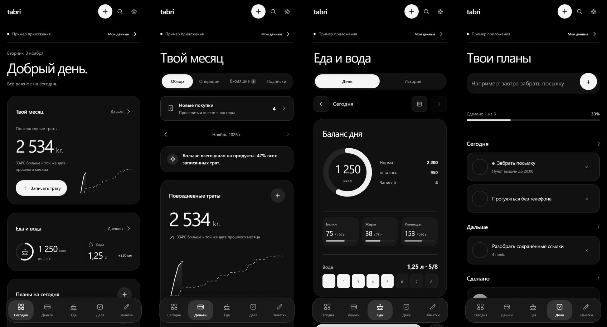

# tabri

Деньги, подписки, еда и вода, дела и заметки в одном Android-приложении. Всё важное на сегодня — на одном экране.

*Money, subscriptions, food and water, tasks and notes in one Android app. Russian and English.*

**[⬇ Скачать tabri.apk](https://github.com/wexwxee/tabri-releases/releases/latest/download/tabri.apk)** · Android · альфа-версия

На снимках — встроенный пример с выдуманными данными.

## Что внутри

- **Сегодня** — траты за месяц, калории и вода, планы на день.
- **Деньги** — повседневные траты, операции, подписки и новые покупки, которые нужно проверить.
- **Еда и вода** — калории, белки, жиры и углеводы, стаканы воды за день.
- **Дела** — на сегодня, дальше и сделанные, повторяющиеся дела.
- **Заметки.**
- Тёмная и светлая тема, русский и английский язык, выгрузка в JSON, CSV и календарь.

## Твои данные

Всё хранится только на телефоне. Аккаунта, облака и подключения к банку нет. Сделать копию можно через выгрузку в файл.

## Как установить

1. Скачай **tabri.apk** по кнопке выше.
2. Открой файл. Android попросит разрешить установку из этого источника — разреши.
3. Новые версии приходят через кнопку «Обновить» в самом приложении.

Версии с пометкой «(test)» в списке выпусков — пробные. Обычная ссылка для скачивания всегда ведёт на последнюю нормальную версию.

---

Исходный код закрыт, здесь публикуются готовые сборки. Версии для iPhone пока нет.
